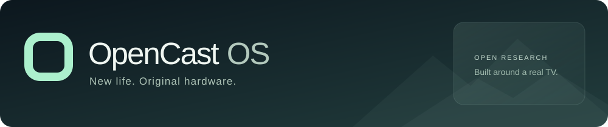
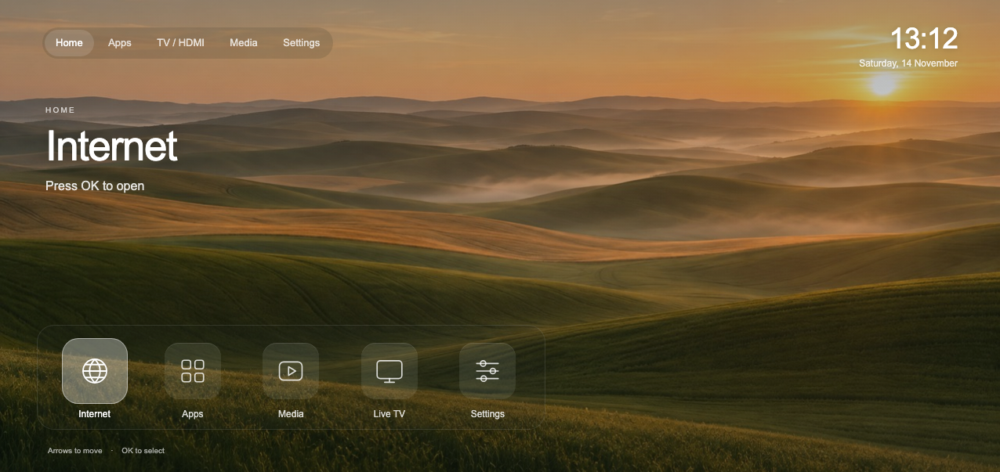

<p align="center">
  
</p>

<p align="center">
  
  
  <a href="LICENSE"></a>
</p>

<p align="center">
  <a href="docs/knowledge-graph.md"><strong>Explore the knowledge graph</strong></a> ·
  <a href="#try-it-locally">Try it locally</a> ·
  <a href="#build-with-us">Build with us</a>
</p>

## A new chapter for an existing screen

A television can outlive the software experience it shipped with. OpenCast OS is an open-source effort to give a **2013 LG NetCast TV** a modern, thoughtful interface while keeping its original hardware useful.

The long-term goal: turn on the TV and arrive directly in OpenCast, with a replacement launcher, intuitive remote navigation, compatible media experiences and the essential functions intact—picture, sound, HDMI, tuner and power management. The path runs through embedded Linux, firmware analysis, interface design and careful experiments on a real device.

**Research target:** LG **47LA620S-ZA**, firmware **04.28.17**. This is NetCast, not webOS. Findings from this unit do not imply support for other models.

> **Current stage:** there is no installable replacement OS or verified autostart integration. A browser probe has run on the physical TV; the richer launcher below has been validated on desktop only. Recovery and native integration remain open engineering work.

## A first look



*Desktop preview of the working launcher prototype, tested with a 1276 × 603 browser viewport. This is not a photograph or capture of the TV.*

Five sections—**Home, Apps, Inputs, Media and Settings**—share a restrained visual language: quiet landscapes, a compact translucent dock, clear focus and generous spacing. Navigation and local appearance settings work. Native TV actions explicitly report their unavailable status.

The prototype uses conservative HTML, CSS and JavaScript, with no framework runtime or external assets. The landscape is static; live blur and continuous animation are absent. Responsiveness on the actual TV will decide which effects survive. [Design and implementation →](docs/shell-prototype.md)

## What we have established

| Area | Evidence so far |
| --- | --- |
| **Device communication** | Exact-target SSDP discovery, read-only UDAP/DLNA descriptions and local connectivity verified. |
| **Physical execution** | Our browser probe appeared on the TV, received clicks and returned to Smart through Home. Browser arrows moved a cursor; direct D-pad delivery remains unresolved. |
| **Firmware understanding** | Official firmware preserved and analyzed locally. Selected binaries identify ARM32 little-endian EABI5; boot paths, partitions and vendor dependencies are being mapped. This is firmware evidence, not a full hardware inventory. |
| **Launcher development** | A working static shell, an explicit capability boundary, bounded diagnostics and automated host tests. No fabricated HDMI switching or app launches. |

The [experiment log](docs/experiments.md), [firmware analysis](docs/firmware-extraction.md) and [current handover](docs/handover.md) preserve the detail—including failures, uncertainty and validation limits.

## Explore the engineering, not just the interface

The **[knowledge graph](docs/knowledge-graph.md)** connects the questions that determine feasibility: firmware → ABI → vendor processes → graphics and input → boot integration → recovery.

Start with the [knowledge index](knowledge/index.md), browse the GitHub-rendered graph, or open the repository's [interactive graph](knowledge/graph.html) locally after cloning. The interactive file is a local artifact, not a hosted web service. Concepts link to detailed evidence so an attractive hypothesis cannot silently become a confirmed fact.

For focused exploration from the repository root:

```sh
python3 -m tools.knowledge overview
python3 -m tools.knowledge context product/shell --depth 1 --max-nodes 8 --byte-budget 12000
```

## Try it locally

Use **Python 3.11+** and **Node.js 18+** for host development. The baseline tools use Python's standard library; optional cryptographic analysis has [separate pinned dependencies](requirements-firmware.txt). Node runs on the development computer, not the television.

```sh
git clone https://github.com/lbm410/OpenCast-OS.git
cd OpenCast-OS
python3 -m http.server 8766 --bind 127.0.0.1 --directory prototypes/opencast-shell
```

Open **http://127.0.0.1:8766** for the desktop launcher. This serves only its static directory on loopback; it does not install anything on the TV. In another terminal, run the host checks:

```sh
python3 -m unittest discover -s tests -v
node --test tests/test_*.cjs
```

Cryptographic tests may skip without the optional dependency. For device work, follow the [physical-test protocol](docs/hello-world.md) and [recovery boundaries](docs/recovery.md). Never expose the repository or the TV to the public Internet.

## The road ahead

1. **Understand the platform:** deepen the boot, service, graphics and input dependency map.
2. **Prove the interaction:** establish reliable physical remote navigation and repeatable execution.
3. **Connect real capabilities:** integrate verified TV controls and viable local media paths.
4. **Earn startup integration:** demonstrate recovery and safe coexistence before persistent changes.
5. **Measure and refine:** compare real-device latency, memory and stability against the original experience.

No current streaming-service compatibility, performance improvement or safe firmware replacement is promised. Each step needs evidence. [Architecture →](docs/architecture.md) · [Performance criteria →](docs/performance.md)

## Build with us

Contributions in embedded Linux, NetCast research, binary analysis, accessible TV interfaces and reproducible testing are welcome. Read [the working guidelines](AGENTS.md), choose a documented unknown and bring a testable result. Preserve evidence labels and keep private captures, device identifiers, credentials and vendor binaries out of contributions.

## About the creator

Created and maintained by **[Lucas Barrientos](https://github.com/lbm410)**, software engineer. OpenCast brings systems engineering and interface design together around a simple ambition: make existing hardware worth using for longer.

[Portfolio](https://lucasbarrientos.es) · [GitHub](https://github.com/lbm410) · [LinkedIn](https://www.linkedin.com/in/lucasbarrientosdev/)

---

[GPLv3](LICENSE). Vendor firmware is **not redistributed**; third-party components retain their respective licenses. OpenCast OS is an independent project and is not affiliated with LG Electronics.
