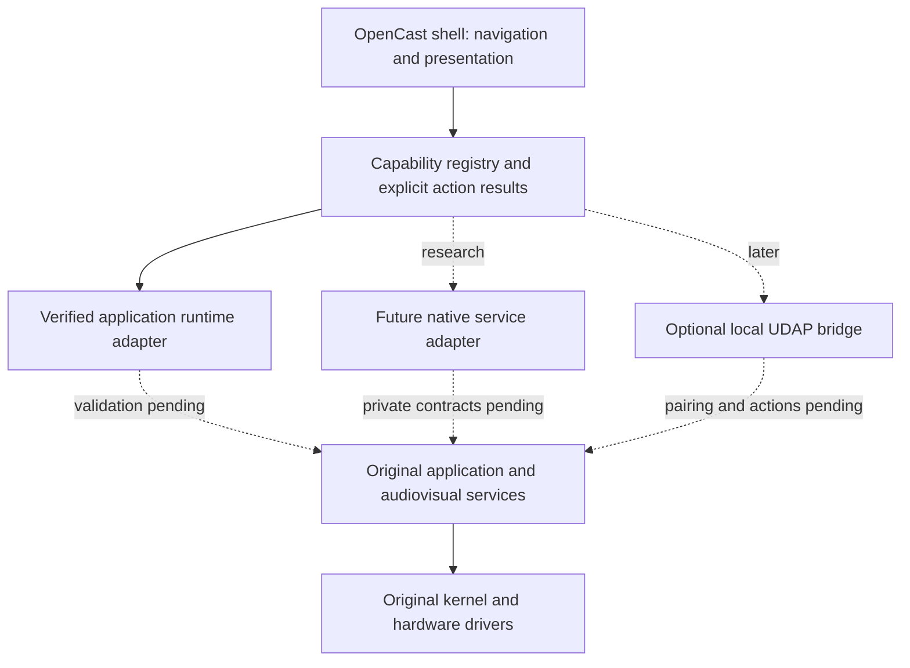

# OpenCast OS architecture direction

Status: research architecture, 2026-11-14. No installable replacement OS or automatic startup is implemented.

## Current leading hypothesis

Run an independently hosted OpenCast shell while retaining the original kernel, hardware drivers and essential vendor services. Use a verified application/runtime entry point first. Treat unattended launch at power-on as a distinct integration milestone requiring boot supervision and recovery evidence.

The static firmware provides ARM32 EABI5 executables, a Linux3.0.13 kernel, a RELEASE executable linked to audiovisual/vendor components, a Home.swf application manifest, and browser/native service wrappers. The recovered input wrapper constructs messages for a named vendor service; this is a concrete investigation path for coexistence. It does not yet establish an accessible, supported or stable runtime contract.

## Separation of responsibilities

The shell owns visual layout, remote focus, sections and noncritical preferences. It must not claim a connection or successful TV operation merely because a card was clicked. Unsupported actions remain explicitly unavailable. Native/back/Home semantics depend on the verified runtime; never globally intercept exit routes to make navigation appear functional.

Adapters expose only individually verified capabilities, such as app enumeration, app launch, input selection or volume. Each operation needs an explicit result, bounded timeout and actionable unavailable/error state. Device credentials belong in a local protected bridge store, never in shipped JavaScript or repository files. Browser mode, official application mode and native mode have different APIs and are separate adapters.

RELEASE is not assumed disposable. Its real dynamic dependencies and native definitions include TV, graphics, audio/video and watchdog-related components. Preserve it until process/service ownership is understood. Replacing the Home resource alone is also not an established replacement mechanism: manifests, integrity, lifecycle and runtime coupling remain unresolved.

Host tools remain separate from runtime code. `tools/` contains bounded discovery, firmware container/filesystem metadata readers, static ELF and partition/LZ4P inspection, and the probe server. Proprietary inputs and raw local evidence stay ignored. The shell prototype contains only project assets/code and no vendor binaries.

## Visual implementation policy

See visual-direction.md. Use conservative JavaScript, local assets and semantic buttons. Build subtle glass with cheap transparency/borders and a static landscape first. Evaluate motion, rendering resolution, compositing and memory on the target; desktop screenshots are layout checks only.

## Decision gates

1. Reversible application execution: demonstrate actual D-pad input, repeat launch and normal exit in an appropriate runtime. Current browser baseline confirms code/clicks/Home return, not direct key delivery.
2. Coexistence: identify graphics/input registration and an application entry point that retains original TV/HDMI/audio/power behavior. Static named-service wrappers are leads, not tested APIs.
3. Essential controls: verify supported action contracts one at a time and their failure paths. Siri integration is deferred and can use a separate bridge.
4. Automatic startup: identify active boot selection, process supervision, watchdogs, update persistence and a recovery method demonstrated for this hardware. Paired partitions in an update template do not pass this gate.
5. Deeper distribution/kernel replacement: evaluate driver licensing/availability and recovery only after the preceding evidence; preserve this option as research rather than pretending a generic Linux image will support the panel/tuner.

No gate is satisfied solely by root access, an ARM executable, a successful host test or a polished screen.
