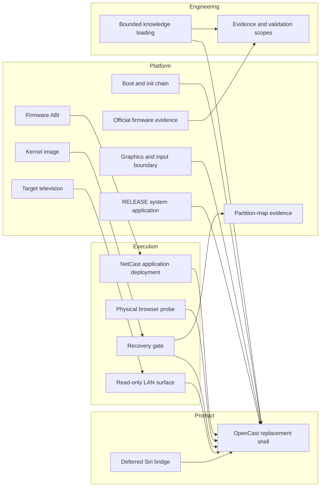

# Explore the OpenCast knowledge graph

**16 concepts · 63 directed relationships · 4 groups.** Built from the actual OKF bundle, not a hand-drawn architecture claim.

[Open the bundle index](../knowledge/index.md) or [download the interactive graph](../knowledge/graph.html). GitHub displays the HTML source; save the repository and open `knowledge/graph.html` locally for search, filters and selectable connections. No hosting, CDN, installation or network fetch is required. Keep the repository layout for its manual Markdown/report links.

The navigation overview below includes all concepts and 15 actual relationships selected as a spanning forest. Arrow direction is preserved. The local viewer contains all 63 relationships and shows only the selected node's connections to keep the map readable. A link means a knowledge relationship; its surrounding concept prose explains the dependency or evidence context.

All current summaries are draft and unverified in OKF's review-event sense. Their evidence labels distinguish physical observations, static results and open hypotheses; they do not imply a working replacement OS.



If a renderer disables Mermaid click actions, use these ordinary links:

## Product

- [OpenCast replacement shell](../knowledge/product/shell.md) — A modern shell over retained vendor services is the leading unproven integration architecture.
- [Deferred Siri bridge](../knowledge/product/siri.md) — Voice control is a separate local-adapter investigation, not a completed feature.

## Execution

- [NetCast application deployment](../knowledge/execution/app-deployment.md) — Official app packaging is a useful comparison route with unresolved end-to-end availability.
- [Physical browser probe](../knowledge/execution/browser.md) — Own code ran on the TV, while direct D-pad input and repeat-load acceptance remain incomplete.
- [Read-only LAN surface](../knowledge/execution/local-control.md) — Discovery established UDAP and DLNA descriptions, not tested television control actions.
- [Recovery gate](../knowledge/execution/recovery.md) — Persistent integration requires a demonstrated recovery procedure for this exact hardware.

## Platform

- [Firmware ABI](../knowledge/platform/abi.md) — ARM executable evidence without claiming an established native deployment environment.
- [Boot and init chain](../knowledge/platform/boot.md) — Shipped startup paths and the gaps before asserting live process supervision.
- [Official firmware evidence](../knowledge/platform/firmware.md) — Container identity, integrity coverage and preserved offline analysis inputs.
- [Graphics and input boundary](../knowledge/platform/graphics-input.md) — Static graphics/runtime evidence and the unresolved path to native remote navigation.
- [Kernel image](../knowledge/platform/kernel.md) — Decoded Linux image evidence and unresolved board-level dependencies.
- [Partition-map evidence](../knowledge/platform/partitions.md) — Static paired storage regions do not establish active banks or automatic rollback.
- [RELEASE system application](../knowledge/platform/release.md) — The main executable is coupled to television services, not proven to be a disposable launcher.
- [Target television](../knowledge/platform/target.md) — Exact target identity and the boundary between owner, network and physical hardware evidence.

## Engineering

- [Bounded knowledge loading](../knowledge/engineering/knowledge-loading.md) — Load one task concept and its immediate neighbors before opening detailed reports.
- [Evidence and validation scopes](../knowledge/engineering/validation.md) — Host tests, static firmware results and physical observations answer different questions.

## Rebuild the views

```sh
python3 -m tools.knowledge_view
python3 -m tools.knowledge_view --check
python3 -m unittest discover -s tests -p 'test_knowledge_view.py' -v
```

The generator reads concepts and graph edges without fetching source resources. Concept text is displayed as text, never interpreted as HTML. Generated views are deterministic; detailed reports remain the evidence record.

The initial 2026-11-14 export passed six generator tests covering script-termination injection, unsafe links, deterministic HTML/Markdown/SVG, real graph counts and malformed concept relationships. Local isolated Chrome checks confirmed search, category filtering, node selection and neighbor navigation, with no JavaScript exceptions. Desktop (1600 × 1150) and mobile-width (390 × 844) screenshots were inspected; neither layout had horizontal overflow. These checks validate the documentation viewer on the host, not the TV runtime.
